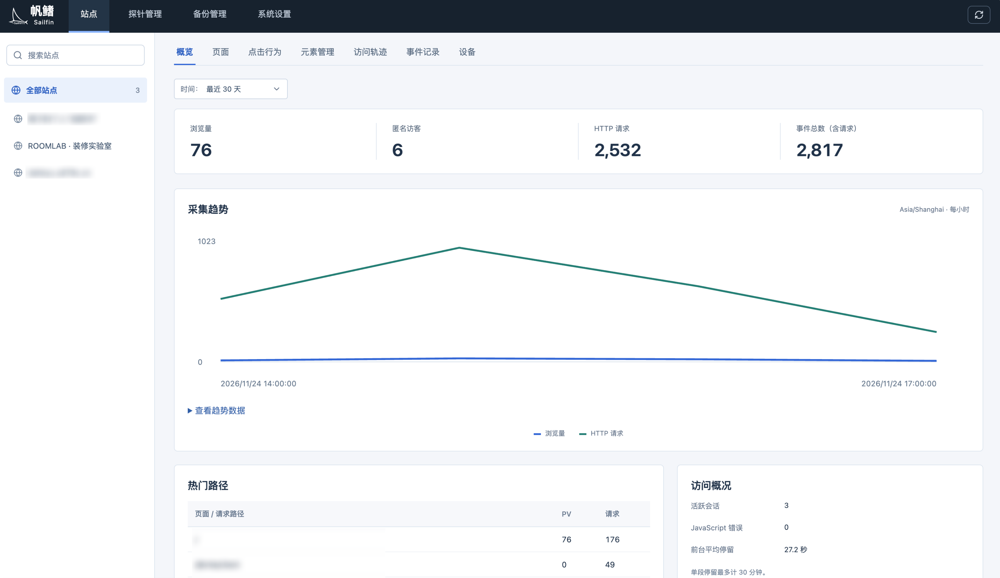
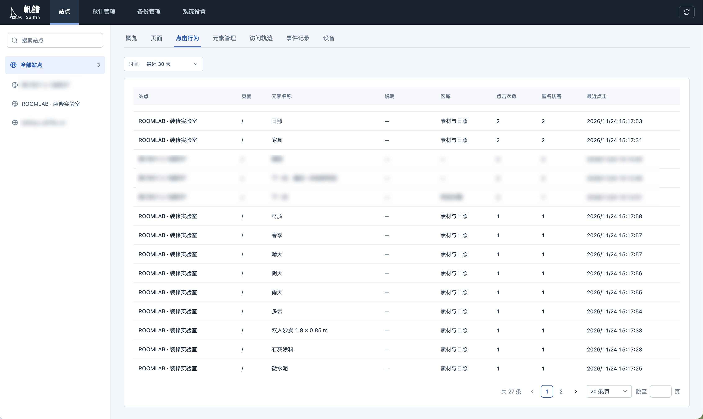
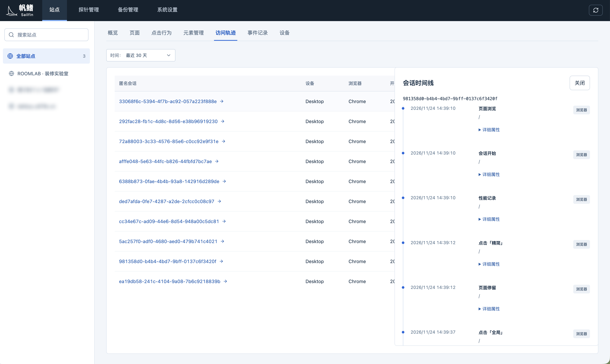
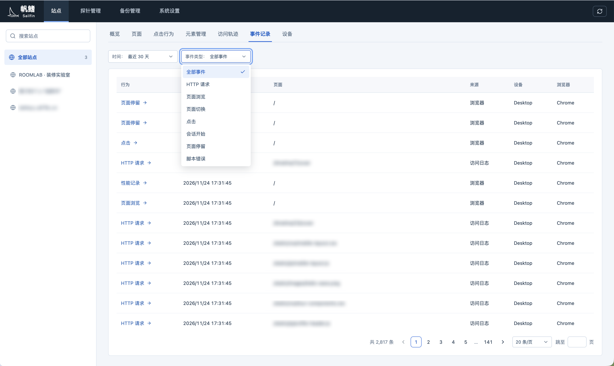
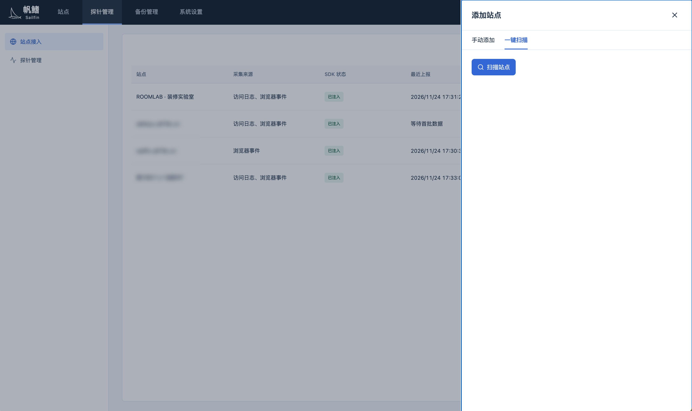
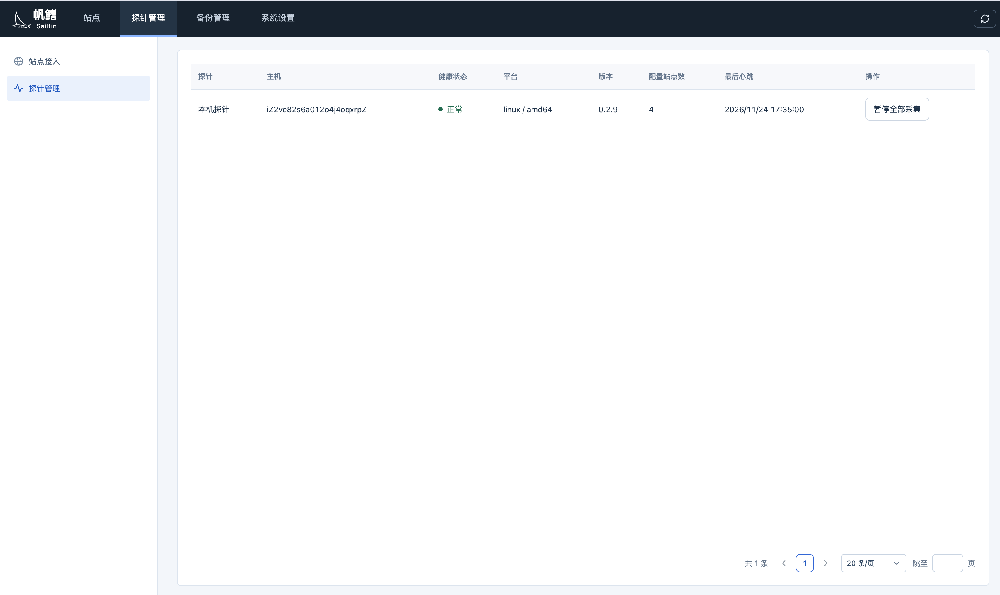
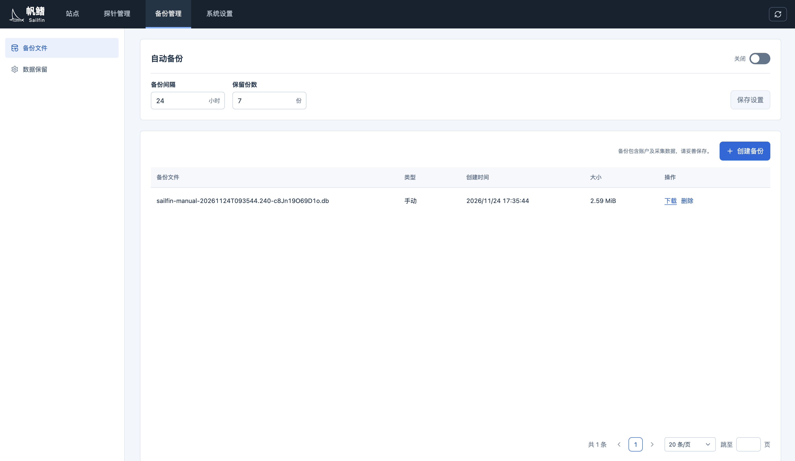
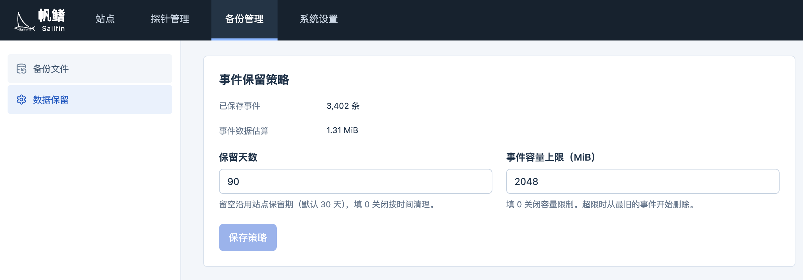
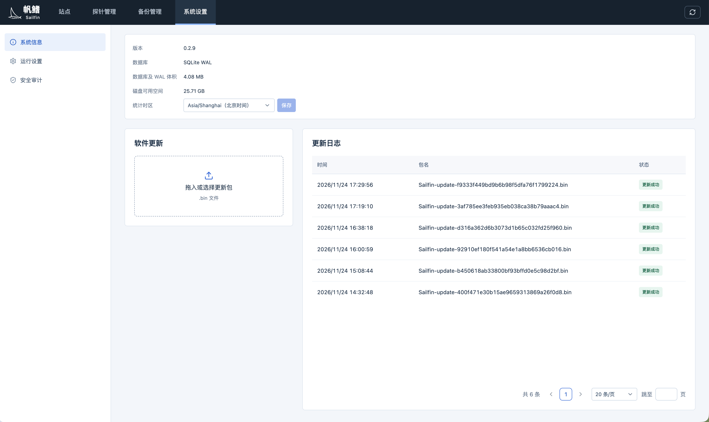
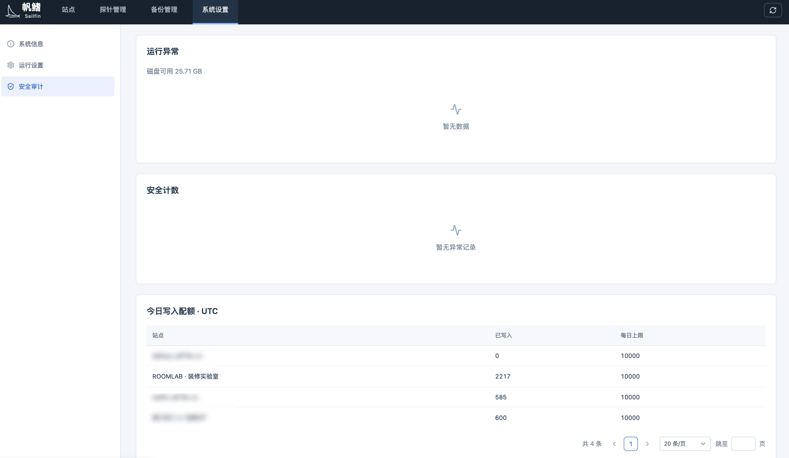

## 站点分析

### 站点概览

按站点和时间范围查看浏览量、匿名访客、HTTP 请求、采集趋势和热门路径。

### 点击行为

按站点、页面和元素查看点击次数、匿名访客、元素说明和最近点击时间。

### 访问轨迹

打开匿名会话，沿时间线查看页面浏览、点击、停留和性能事件。

### 事件记录

按时间和事件类型筛选浏览器事件与访问日志，打开记录查看详情。

## 探针管理

### 站点接入

在「添加站点」抽屉中手动填写采集来源，或扫描可接入的站点。站点列表显示各站点的采集来源、SDK 状态和最近上报时间。

### 探针状态

查看本机探针的健康状态、运行平台、版本、配置站点数和最近心跳，可从此处暂停或恢复采集。

## 备份与数据保留

### 备份文件

创建和下载 SQLite 快照，按需开启自动备份并设置备份间隔和保留份数。

### 数据保留

查看已保存事件数和数据量估算，配置保留天数与事件容量上限。

## 系统设置

### 系统信息与软件更新

查看版本、数据库大小、磁盘空间和统计时区。上传更新包后，可在更新日志中查看安装结果。

### 安全审计

查看运行异常、安全计数和各站点当日写入配额。

